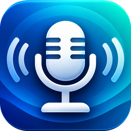

<p align="center">
  
</p>

<h1 align="center">wdys: What did you say?</h1>

<p align="center">
  Private, local voice dictation for Windows.<br>
  Hold a key, speak, let go: your words are pasted into whatever app you're in.
</p>

<p align="center">
  <a href="https://github.com/brianbarnes-github/wdys/actions/workflows/ci.yml"></a>
  <a href="https://github.com/brianbarnes-github/wdys/releases/latest"></a>
  <a href="LICENSE"></a>
</p>

---

wdys is a tiny tray app for people who would rather talk than type, especially into AI chat boxes. It runs in
the background, listens only while you hold a key, transcribes with [Whisper](https://github.com/openai/whisper)
**entirely on your computer**, removes the "um"s and "uh"s, and pastes the text into the app you're using.

- **Local and private.** Your voice never leaves your PC. No account, no cloud, no telemetry. The only network
  use is a one-time download of the speech model, and it asks first.
- **Fast and light.** One ~5 MB `.exe`, about 20 MB of memory while idle, no CPU use when you're not talking.
  The speech model is unloaded after 10 idle minutes.
- **Works in any app.** It pastes with Ctrl+V, so it works anywhere you can paste: browsers, chat apps,
  editors, terminals.
- **Hands-free mode.** Double-press the key to keep recording without holding it. A small pulsing dot shows
  at the top of the screen so you always know it's on.
- **Cleans up after you.** Filler words ("um", "uh", "ah", "er", "hmm") and short stutters ("I I I want")
  are removed.
- **Never loses your words.** If a paste fails, the text is left on your clipboard, and the tray menu can copy
  your last dictation again.

> **Status:** early release (v0.1). The core logic is covered by automated tests, but the app has had limited
> real-world use so far, so expect rough edges. Bug reports are very welcome.

## Download and install

1. Go to the **[latest release](https://github.com/brianbarnes-github/wdys/releases/latest)** and download
   `wdys-…-windows-x64.zip`.
2. Unzip it anywhere you like, for example `C:\Tools\wdys`.
3. Double-click `wdys.exe`. A microphone icon appears in the system tray. On Windows 11 it may be hidden under
   the **^** arrow; drag it out to keep it visible.
4. The first time, wdys asks to download its speech model (about 148 MB). Click **Yes**. This happens once.

That's it. There's no installer. Everything stays in your user profile: `%APPDATA%\wdys` holds the settings and
the model, plus a couple of per-user registry entries (one so Windows can show wdys notifications, and one only if
you turn on **Start with Windows**).

**Requirements:** Windows 10 or 11, 64-bit, and a microphone.

### "Windows protected your PC" warning

wdys is a new, unsigned program, so Windows SmartScreen (and some antivirus tools) may warn about it. This is
normal for small open-source apps that don't pay for a code-signing certificate. If you want to run it, click
**More info**, then **Run anyway**. You can check the download against the `SHA256SUMS.txt` file published with
each release, or [build it yourself](#building-from-source) from the source here.

## How to use it

The default hotkey is **F9**.

| You do | What happens |
| --- | --- |
| **Hold** F9, speak, **release** | Recording stops, the text is transcribed and pasted into the focused app. |
| **Double-press** F9 | Hands-free mode: keeps recording until you press F9 once more. A pulsing red dot appears at the top of the screen. |
| **Press F9 again** (in hands-free) | Stops, transcribes, and pastes. |
| A quick tap | Ignored (taps shorter than 0.3 s are treated as accidents). |

Recordings are capped at 2 minutes (adjustable) so a forgotten recording can't run forever.

### The hotkey is blocked while wdys runs

wdys *swallows* the hotkey so it never types a character or triggers a shortcut in the app you're dictating into.
The flip side is that **that key stops working normally in every app** while wdys is running. So choose a key you
never use: an F-key or Scroll Lock works well. Don't pick a letter or a modifier like Ctrl.

Change it any time from the tray: **Set hotkey...**, then press the key you want.

### Tray menu

| Item | What it does |
| --- | --- |
| **Set hotkey...** | Pick a new hotkey (a toast tells you when to press it and confirms the key). |
| **Copy last transcript** | Puts your most recent dictation back on the clipboard. |
| **Model: base / small** | Choose the speech model. *base* is faster; *small* (~488 MB) is more accurate. Takes effect after a restart. |
| **Start with Windows** | Launch wdys when you sign in. |
| **Open config file** | Edit advanced settings in Notepad. |
| **Quit** | Exit wdys. |

The tray icon is the app icon with a small status dot: none when ready, **red** recording, **orange**
hands-free, **violet** transcribing, **yellow** an error (hover for the message; errors also pop up as a toast).

## Settings

Most settings live in the tray menu. Everything is in `%APPDATA%\wdys\config.toml` (use **Open config file**),
and a missing option falls back to its default:

```toml
hotkey = 120              # Windows virtual-key code, decimal (120 = F9). Easier: use "Set hotkey..."
model = "base-en"         # "base-en" or "small-en" (English-only models)
max_recording_secs = 120  # a recording is ended automatically after this long
idle_unload_secs = 600    # unload the model from memory after this much idle time
double_press_ms = 400     # window for the second press of a double-press
min_hold_ms = 300         # holds shorter than this are treated as accidental taps
sounds = true             # short sounds when recording starts, stops, or something goes wrong
start_with_windows = false
```

## Privacy

- Audio is processed in memory on your computer and is never saved or sent anywhere.
- The **only** network connection wdys ever makes is downloading the Whisper model from Hugging Face, once,
  after you click Yes. The download is checked against a known SHA-256 checksum. You can skip it entirely by
  placing `ggml-base.en.bin` (or `ggml-small.en.bin`) from
  [ggerganov/whisper.cpp](https://huggingface.co/ggerganov/whisper.cpp) in `%APPDATA%\wdys\models`.
- Only your **last** transcript is kept, in memory, and it's gone when you quit. Nothing is written to disk.
- While pasting, wdys briefly uses your clipboard and then restores what was there (text only), and it asks Windows
  to keep the dictated text out of clipboard history.

## Limitations

- **English only**, and CPU only (no GPU acceleration yet).
- It can't paste into windows running **as administrator** unless wdys is also run as administrator.
- The clipboard restore after a paste keeps **text only**. If you had an image on the clipboard, it is lost.
- Accuracy is Whisper's: very good, not perfect. The filler-word cleanup is rule-based, so it won't fix a
  sentence you rephrase halfway through.
- Whisper occasionally invents text (such as "Thank you.") from background noise on a very short recording.
- Windows only.

## Troubleshooting

- **I can't see the tray icon.** On Windows 11, click the **^** arrow in the taskbar; drag the icon out to pin it.
- **Nothing pasted.** Check the tray icon: a yellow dot and a toast mean something went wrong, and your text is
  usually on the clipboard (press Ctrl+V). Also, you can't paste into an administrator window (see above).
- **No toast notifications.** Windows Focus Assist / Do Not Disturb hides them; check the notification center.
- **My F9 key does nothing anywhere.** That's by design while wdys runs. Pick another key with **Set hotkey...**
  or quit wdys.
- **"No input device".** Make sure a microphone is connected and set as the default recording device in Windows
  sound settings.
- **The model download failed or was declined.** Quit and restart wdys to be asked again, or download the model
  by hand (see [Privacy](#privacy)).
- **Start over.** Quit wdys and delete `%APPDATA%\wdys`.

## Building from source

wdys is written in Rust. The speech engine ([whisper.cpp](https://github.com/ggml-org/whisper.cpp), through the
[`whisper-rs`](https://github.com/tazz4843/whisper-rs) bindings) is compiled from C++ as part of the build.

**From Ubuntu / WSL** (this is how releases are built):

```bash
sudo apt install mingw-w64 cmake libclang-dev
rustup target add x86_64-pc-windows-gnu
scripts/build-windows-from-wsl.sh            # builds target/x86_64-pc-windows-gnu/release/wdys.exe
scripts/build-windows-from-wsl.sh /mnt/c/Tools/wdys   # ...and copies it somewhere
```

**On Windows** (MSVC toolchain): install Rust, the Visual Studio C++ Build Tools, CMake, and LLVM (for
`libclang`), then `cargo build --release`. This path is untested so far; if it works (or doesn't) for you,
please open an issue.

**Tests.** All the logic is covered by automated tests that run on any OS with no audio hardware:

```bash
cargo test --no-default-features
cargo clippy --no-default-features --all-targets -- -D warnings
```

The Windows layer (keyboard hook, clipboard, microphone, tray, toasts, overlay) can only be checked on a real
machine: see [docs/MANUAL_TESTING.md](docs/MANUAL_TESTING.md). Design background is in
[docs/DESIGN.md](docs/DESIGN.md).

### How it's put together

The core is plain functions and small traits (`Recorder`, `Clipboard`, `Keyboard`, `SpeechModel`, ...) so it can be
tested without Windows or a microphone; a thin `src/platform/` layer implements them with Win32, `cpal` and
`tray-icon`.

| Module | Job |
| --- | --- |
| `hotkey` | Pure state machine: hold, tap, double-press, hands-free, max length, and the hook's block/forward decisions. |
| `filler` | Removes filler words, stutters and Whisper markers. |
| `audio`, `transcribe`, `whisper` | Audio conversion, lazy model loading with idle unload, and the whisper.cpp binding. |
| `paste` | Clipboard-based paste with restore, and the "never lose the text" fallback. |
| `model_store` | Model download, checksum verification, consent. |
| `app` | Wires it all together; one worker thread owns recording and transcription. |
| `platform/*` | Windows-only: keyboard hook, clipboard, microphone, tray, toasts, overlay, autostart, single-instance. |

## Contributing

Issues and pull requests are welcome. See [CONTRIBUTING.md](CONTRIBUTING.md).

## License

[MIT](LICENSE). Third-party components, including the Whisper model, whisper.cpp and the Rust crates used, are
listed in [THIRD_PARTY_NOTICES.md](THIRD_PARTY_NOTICES.md).

wdys is built on [OpenAI Whisper](https://github.com/openai/whisper), [whisper.cpp](https://github.com/ggml-org/whisper.cpp)
and [whisper-rs](https://github.com/tazz4843/whisper-rs). Thank you to everyone behind them.
